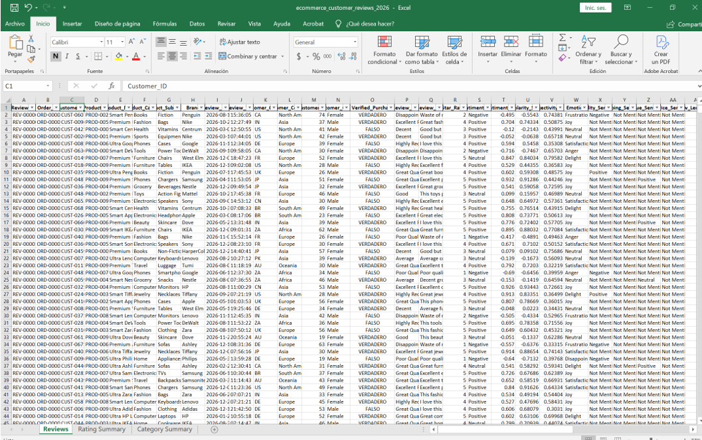
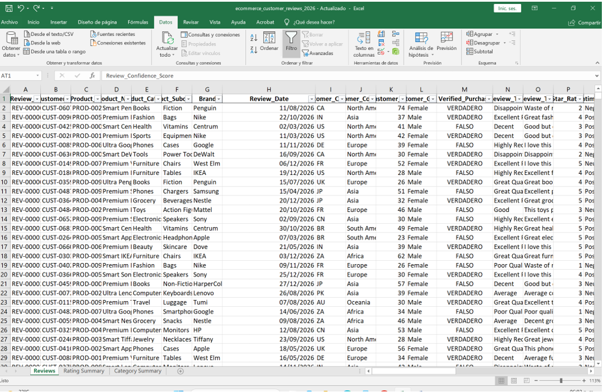

# 05. Datos ordenados

## Captura del antes: tu dataset del proyecto tal como lo descargaste

## Tres problemas que encontraste y cómo los corregiste
* **Formato de fechas:** La columna `Review_Date` tenía las fechas en formato `AAAA-MM-DD` (además de estar guardadas como texto/formato General), por lo que se transformaron mediante *Texto en columnas* a formato de fecha `DD/MM/AAAA`.
* **Columnas innecesarias:** Se eliminaron columnas de identificadores o metadatos que no aportan valor al modelo ni a la visualización (por ejemplo: `Order_ID`, `Product_ID`, `Review_Time`, `Review_Length_Characters`, etc.).
* **Variables sin varianza (constantes):** Se detectaron columnas donde el 100% de los registros tenían el mismo valor (como `Shipping_Sentiment` y `Service_Sentiment` en *Not Mentioned*, o indicadores booleanos todos en *FALSO*), por lo que se depuraron para evitar ruido en el análisis.

## Captura del después: tus datos como tabla de Excel con nombre

## Una pregunta sencilla de tu proyecto respondida con ordenar o filtrar
* **Pregunta:** ¿Cuántas categorías de productos se están tomando en cuenta y cuáles son?
* **Respuesta:** **18 categorías:** Baby, Beauty, Books, Computers, Electronics, Fashion, Furniture, Grocery, Health, Home, Jewelry, Office, Pets, Phones, Sports, Tools, Toys y Travel.